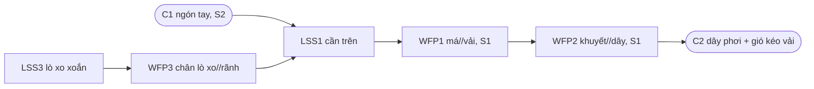

# helix-cc2-analyze — Khối CA: hình thể có sẵn → mô hình C&C² → giả thuyết chức năng

> **Vai:** chiều phân tích, chạy độc lập hoặc trong luồng. `--analyze`: chỉ CA (có thể nối C4). `--improve`: CA chạy
> trước C0 để C0 biết hình thể hiện có và chỗ hỏng. C6: gọi CA ở chế độ `--crosscheck` để đối chiếu ngược.
> **Đầu vào:** hình thể (bản vẽ, `cad_extract.json`, ảnh, mô tả) | **Đầu ra:** `{{prefix}}CC2_CA_Analysis.md` |
> **Đọc bởi:** C0 (`--improve`), C4 (`--analyze`), C6
> **Nguồn dùng chung:** `helix-cc2:references:cc2-core` (§Từ vựng, §Bảy bước dựng mô hình, §Hai loại nhãn, §Giới hạn dùng
> và bằng chứng, §Phạm vi cứng), `helix-cc2:references:view-ops` (§Rào cản quan sát, sáu phép), `helix-cc2:references:hypothesis-sheet`
> (§Khuôn phiếu, §Điều kiện hợp lệ), `helix-cc2:references:multidomain` (§Chỗ phải dừng), `helix-cc2:references:param-bridge`
> (§Tham số, không phải tác dụng).

## Đầu vào

- Một hình thể đọc được, theo thứ tự ưu tiên:
  - `cad_extract.json` từ `helix-cad-ingest` (hoặc `helix-cad-bridge`): đọc danh sách đặc điểm hình học và kích thước có
    trong tệp; không đoán thêm kích thước tệp không ghi.
  - Bản vẽ hay mặt cắt, ảnh mẫu thử ở trạng thái đang làm chức năng.
  - Mô tả bằng lời. Chỉ có mô tả thì mọi quan hệ ghi được tối đa là `phỏng đoán`.
- Nên có: câu hỏi phân tích (mục đích bước (a)), biên bản hỏng hay dữ liệu hiện trường của chính Xưởng.
- CA không có Purpose Gate, không có ACCESS LEVEL, không OSINT; khi đích là sản phẩm của bên khác hay của đối thủ, dùng `/reverse-engineering` thay cho khối này.
- Chế độ dự án: ghi `{{prefix}}CC2_CA_Analysis.md` vào `<nơi ghi>/<F-id>/`.

## Luật cứng

1. **Phạm vi một trang.** Mô hình chỉ gồm ≤ 2 chức năng con chính + ≤ 3 tới hạn *(quy ước bộ skill, theo `cc2-core` §Phạm vi cứng)*;
   không mô hình hoá cả sản phẩm. Mỗi hình vẽ tay lại được trên một trang A4; không vừa thì vẽ thô hơn.
2. **Bảy bước là danh mục việc phải xong** (`cc2-core` §Bảy bước dựng mô hình): mục đích là câu hỏi *đặc điểm nào*, không hỏi
   *sửa thế nào*; ảnh hệ ở trạng thái đang làm chức năng; WFP, LSS, Connector gắn lên ảnh, mỗi phần tử ghi trạng thái.
3. **Nhãn** (`cc2-core` §Hai loại nhãn): mọi câu «do X nên Y» mang `tri thức` / `phỏng đoán` / `giả định`. `tri thức` chỉ khi
   có bằng chứng cụ thể (biên bản thử, hiện vật, phép tính có người ký); hình học trông hợp lý chưa phải bằng chứng.
4. Bảng `Vì sao hình học này` *(khuôn bảng là quy ước bộ skill)*: mỗi đặc điểm hình học một dòng, gắn đúng một phần tử
   (WFP/LSS/C kèm trạng thái), một câu vì sao (chức năng nó phục vụ), nhãn, và một phép thử nhỏ nhất để bác bỏ. Không viết
   được vì sao thì ghi `chưa rõ` và đưa vào rào cản quan sát, không bịa lý do.
5. **Tham số, không phải tác dụng** (`param-bridge` §Tham số, không phải tác dụng): giả thuyết nháp đặt ở NẾU một tham số
   ghi được lên bản vẽ.
6. **Rào cản quan sát** (`view-ops` §Rào cản quan sát): mỗi chỗ chưa thấy được ghi một dòng rào cản + phép phá. Phép theo
   rào cản: quá nhanh → `state`; quá chậm → `state` hoặc `observe`; bị che → `observe` hoặc `shift`; quá nhỏ / quá lớn →
   `zoom-in` hoặc `observe` với mẫu tỉ lệ; sai góc nhìn → `view`; ngoài biên → `shift` hoặc `zoom-out`.
7. **Chỗ C&C² dừng** (`multidomain` §Chỗ phải dừng): phần nằm trong mạch điện tử hay phần mềm thành một Connector có tên.
8. **Giả thuyết nháp** theo `hypothesis-sheet` §Khuôn phiếu, mỗi phiếu thêm dòng `Phép thử nhỏ nhất để bác bỏ:`. Mục 7 để
   `người ký {{…}} — ngày {{…}}`; AI không ký. Phiếu nháp phải qua `--kind hypo --allow-unsigned` khi C4 nhận về.
9. Không đưa hồ sơ dự án có IP cho tác tử con làm ví dụ; ví dụ dùng cơ cấu công khai.

## Bước

1. **(a)** Viết câu hỏi phân tích: hiện tượng nào, ở hệ nào, đặc điểm hình thể nào quyết định nó.
2. **(b)** Định biên trong không gian và thời gian; liệt kê Connector ở biên.
3. **(c)** Chọn ảnh hệ (bản vẽ, mặt cắt, `cad_extract.json`, ảnh) ở trạng thái đang làm chức năng.
4. **(d)** Lần dòng năng lượng, vật chất, thông tin qua các phần tử.
5. **(e)** Gắn WFP, LSS, Connector theo từng trạng thái; vẽ Mermaid `flowchart LR`.
6. **(f)** Với từng đặc điểm hình học nổi bật: điền một dòng bảng `Vì sao hình học này` (luật 4).
7. **(g)** Ghi rào cản quan sát gặp phải (luật 6), 1–3 dòng `## Phép nên làm tiếp`, và giả thuyết nháp cho các dòng nhãn
   `phỏng đoán` / `giả định` gánh quyết định lớn nhất.
8. Sau khối: cập nhật cột CA của `_pipeline_state.md`, in tóm tắt 3–5 dòng, hỏi CEO «tiếp / sửa / dừng». Ở `--analyze`, hỏi
   CEO có muốn nối C4 không.

## Khuôn đầu ra: `{{prefix}}CC2_CA_Analysis.md`

````markdown
---
updated: YYYY-MM-DD
f_id: {{F-id hoặc —}}
hình thể: {{đường dẫn hoặc mô tả}}
---
# CC2 CA — Phân tích: {{hình thể}}

> Mọi quan hệ dưới đây là giả thuyết có nhãn cho tới khi qua bàn thử.

## Mô hình C&C² một trang
- Câu hỏi phân tích: {{…}}
- Chính: {{chức năng con chính}}        (≤ 2)
- Tới hạn: {{chức năng tới hạn}}        (≤ 3)
- Trạng thái: {{S1 …, S2 …}}
(Mermaid flowchart LR + bảng phần tử | Phần tử | Loại | Trạng thái | Làm gì | Nhãn |)

## Vì sao hình học này
| Đặc điểm hình học | Phần tử | Vì sao (chức năng nó phục vụ) | Nhãn | Phép thử nhỏ nhất để bác bỏ |
|---|---|---|---|---|

## Rào cản quan sát gặp phải
| Rào cản | Phần tử | Phép phá đề xuất | Câu hỏi kích hoạt |
|---|---|---|---|

## Phép nên làm tiếp
- {{phép}} · {{phần tử}} · {{câu hỏi kích hoạt}}

## Giả thuyết nháp
(khối text theo hypothesis-sheet §Khuôn phiếu, mục 7 để trống cho CEO, thêm dòng Phép thử nhỏ nhất để bác bỏ:)

## Đầu vào cho C0 (chỉ ở --improve)
- Chỗ hỏng / chỗ chức năng mới chạm: {{phần tử, trạng thái}}

## Đối chiếu ngược — phương án {{X-n}} (chỉ khi C6 gọi)
(bảng lệch, xem mục dưới)
````

## Chế độ `--crosscheck` (chỉ C6 gọi)

Gọi: `/helix-cc2-analyze --crosscheck <thư mục trích> <X-n> <n>` — ba tham số của `--crosscheck`, không có cờ riêng:
`<thư mục trích>` là thư mục nháp chỉ chứa ba bản trích dưới đây; `<X-n>` là mã phương án (vd. `A-1`); `<n>` là số GT
đầu tiên được dùng cho phiếu nháp mới (C6 tính từ C4 rồi truyền vào). Đối chiếu ở mức mô tả.

Ai làm: C6 cắt ba bản trích vào `<thư mục trích>` rồi mở một tác tử con mới chỉ với các đường dẫn ấy, không mang ngữ cảnh
phiên lập C1–C3: người đọc ≠ người lập, vì người lập hay đọc bằng chứng phản bác thành xác nhận. CA không đọc gì ngoài `<thư mục trích>`.

Đầu vào được đọc:
- `<thư mục trích>/CC2_C0_Frame.md`: chỉ khung của chức năng con đang xét (thông số chức năng, Connector biên, ràng buộc môi trường)
- `<thư mục trích>/CC2_C2_Forms.md`: chỉ mục của phương án `<X-n>` (mô tả, phác, bảng quy tắc)
- `<thư mục trích>/CC2_C3_Params.md`: chỉ bảng của phương án `<X-n>`

Cấm đọc: `CC2_C1_Chains.md`, `CC2_C4_Hypotheses.md`, mọi tệp ở gốc `<nơi ghi>/` hay trong `<nơi ghi>/<F-id>/`, các phương án khác, và mọi lý lẽ chọn chuỗi (kể cả phần chép lại lý lẽ ấy nếu lọt vào bản trích C2 — gặp thì bỏ qua và ghi một dòng cảnh báo).

Bước:
1. Từ mô tả và phác của phương án `<X-n>`, dựng lại mô hình C&C² một trang **độc lập**, như với một hình thể có sẵn.
2. So với bản trích C0 và C3, ghi mỗi chỗ lệch một dòng, theo năm loại: `L1` phần tử CA thấy mà C3 không có dòng tham số;
   `L2` dòng C3 mà CA không gắn được vào phần tử nào trên hình thể; `L3` thông số chức năng C0 không phần tử nào phục vụ;
   `L4` Connector CA thấy mà C0 không ghi; `L5` chiều ảnh hưởng CA suy ra ngược dấu C3.
3. Mỗi chỗ lệch thành **đúng một** trong hai: `phiếu nháp GT-nnn` (quan hệ hình thể → chức năng cần thử; đánh số từ `<n>`,
   tăng dần) hoặc `dòng sửa C2: …` (mô tả hay phác thiếu, mâu thuẫn).
4. Ghi bảng lệch và các phiếu nháp vào `<thư mục trích>/CA_Crosscheck_<X-n>.md`, mục `## Đối chiếu ngược — phương án <X-n>`.
   C6 đọc tệp ấy vào `{{prefix}}CC2_C6_Crosscheck.md` và nối mục này vào `{{prefix}}CC2_CA_Analysis.md`; CA không tự mở các
   tệp ở nơi ghi.

Ví dụ (nắp gài bằng móc đàn hồi, gọi với `<X-n>` = `A-1`, `<n>` = 4; minh hoạ):

| Lệch | Loại | Thấy ở | Xử lý |
|---|---|---|---|
| Gờ trên thân hộp mỏng, có thể uốn cùng móc khi gài — một LSS thứ hai | L1 | A-1:gờ thân hộp (LSS, S2 gài) | phiếu nháp GT-004: bề dày gờ thân hộp, đối chứng gờ dày hơn, THÌ lực đóng |
| Phác A-1 không ghi khe giữa móc và vách nắp ở trạng thái gài | L2 | A-1:móc//gờ (S2 gài) | dòng sửa C2: ghi khe móc–vách ở S2 vào phác A-1 |
| C0 có Connector ngón tay tháo nắp, phác không chừa chỗ đặt ngón | L4 | C0 Connector biên | dòng sửa C2: thêm mặt đặt ngón ở mép nắp vào phương án A-1 |

## Ví dụ ngắn (kẹp phơi quần áo bằng lò xo xoắn — cơ cấu công khai; không số đo thật)

### Mô hình C&C² một trang

- Câu hỏi phân tích: đặc điểm hình học nào của kẹp quyết định vải không tuột khỏi dây khi gió kéo?
- Chính: giữ vải trên dây phơi khi gió kéo
- Tới hạn: mở được bằng hai ngón tay với lực vừa phải
- Tới hạn: không trượt dọc dây
- Trạng thái: S1 kẹp (không bấm), S2 mở (đang bấm)



| Phần tử | Loại | Trạng thái | Làm gì | Nhãn |
|---|---|---|---|---|
| WFP1 má//vải | WFP | S1 | ép vải, giữ theo phương kéo | phỏng đoán |
| WFP2 khuyết//dây | WFP | S1 | ôm dây qua lớp vải | phỏng đoán |
| WFP3 chân lò xo//rãnh | WFP | S1, S2 | định vị trục xoay, truyền mô-men lò xo | phỏng đoán |
| LSS1 cần trên | LSS | S1, S2 | dẫn mô-men lò xo thành lực ép má; ở S2 dẫn lực ngón | phỏng đoán |
| LSS3 lò xo xoắn | LSS | S1, S2 | tích năng khi mở, trả lực kẹp khi thả | giả định |
| C2 dây + gió | Connector | S1 | tải kéo vải; lời hứa: gió kéo theo phương vuông góc với má | giả định |

### Vì sao hình học này

| Đặc điểm hình học | Phần tử | Vì sao (chức năng nó phục vụ) | Nhãn | Phép thử nhỏ nhất để bác bỏ |
|---|---|---|---|---|
| khuyết lõm bán nguyệt gần mũi má | WFP2 (khuyết//dây, S1) | ôm dây, tăng diện tích tiếp xúc nên kẹp không trượt dọc dây | phỏng đoán | kẹp cùng vải lên dây bằng mẫu có và không có khuyết, kéo dọc dây bằng lực kế tay; không khác thì bác |
| khía ngang trên mặt má | WFP1 (má//vải, S1) | khía cắn vào sợi vải nên vải không tuột theo phương gió kéo | phỏng đoán | so mẫu má phẳng và má có khía trên cùng vải, kéo vải bằng lực kế tay; không khác thì bác |
| rãnh chân lò xo đặt gần má hơn đầu bấm | WFP3 + LSS1 (S1, S2) | cánh tay đòn phía má ngắn nên cùng mô-men lò xo cho lực ép má lớn, còn lực bấm ở đầu dài nhỏ | phỏng đoán | dời rãnh trên hai mẫu tự làm, so lực kéo tuột vải; mẫu rãnh xa má không yếu hơn thì bác |
| đầu bấm loe rộng và cong | C1 (ngón tay, S2) | mặt bấm rộng dàn lực ngón, giả định người dùng mở bằng ngón cái và ngón trỏ | giả định | hỏi năm người mở kẹp đầu loe và đầu thẳng; không ai thấy khác thì bác |

### Rào cản quan sát gặp phải

| Rào cản | Phần tử | Phép phá đề xuất | Câu hỏi kích hoạt |
|---|---|---|---|
| bị che | WFP3 (chân lò xo//rãnh) | `observe`: rà màu ở trạng thái kẹp rồi tháo xem vết | chân lò xo tì vào đâu trong rãnh khi đang kẹp? |
| quá chậm | LSS3 (lò xo xoắn) | `state` theo vòng đời, ảnh cùng góc sau mỗi chặng mở | lực kẹp giảm theo số lần mở hay theo thời gian để ngoài trời? |
| ngoài biên | C2 (dây + gió) | `zoom-out`: đưa vải và dây vào biên | gió kéo vải theo phương nào so với mặt má? |

### Phép nên làm tiếp

- `observe` · WFP3 (chân lò xo//rãnh) · chân lò xo tì vào đâu trong rãnh khi đang kẹp?
- `zoom-out` · C2 (dây + gió) · gió kéo vải theo phương nào so với mặt má?

### Giả thuyết nháp

Phiếu nháp từ dòng rãnh chân lò xo. Ngày thử là minh hoạ; mục 7 để trống cho CEO.

```text
PHIẾU GIẢ THUYẾT — GT-001
1 Tiêu đề: 001 khoảng cách rãnh chân lò xo tới mũi má — phần tử WFP3 + LSS1 (S1 kẹp)
2 NẾU: khoảng cách từ rãnh chân lò xo tới mũi má a = 20 mm | Đối chứng: a = 30 mm, cùng lò xo, cùng gỗ, chỉ khác vị trí rãnh
3 THÌ: lực kéo làm vải tuột khỏi kẹp lớn hơn đối chứng
4 VÌ: cánh tay đòn phía má ngắn hơn nên cùng mô-men lò xo cho lực ép má lớn hơn
5 KIỂM: năm kẹp tự làm mỗi biến thể, cùng một mảnh vải, kéo vuông góc với má bằng lực kế; người đọc kết quả {{tên ≠ người lập}}; ngày thử: 2026-12-01
6 KẾT QUẢ + khuyến nghị: {{điền SAU}}
7 DỰ ĐOÁN VIẾT TRƯỚC: đề xuất — lực kéo tuột của biến thể a = 20 mm lớn hơn đối chứng; người ký {{tên — CEO điền}} — ngày {{YYYY-MM-DD — CEO điền}}
8 ĐỘ TIN / TẦM ẢNH HƯỞNG: trung (cơ chế đòn bẩy quen, chưa đo) / thấp (đổi vị trí rãnh rẻ)
9 NẾU BỊ BÁC: lặp trong pha — xét khía má ở phiếu sau; không mở lại quyết định cổng nào
Nguồn CA: Vì sao hình học này · rãnh chân lò xo đặt gần má hơn đầu bấm
Phép thử nhỏ nhất để bác bỏ: hai kẹp tự làm mỗi biến thể, kéo vải bằng tay qua lực kế; biến thể a = 20 mm không giữ chặt hơn thì bác.
```

## Chạy riêng

```
/helix-cc2-analyze <hình thể> [--out <thư mục>]
/helix-cc2-analyze --crosscheck <thư mục trích> <X-n> <n>     (chỉ C6 gọi, trong tác tử con mới)
```

`<hình thể>` là đường dẫn `cad_extract.json`, bản vẽ, ảnh, hoặc mô tả trong ngoặc kép. Không cần C0–C3 khi chạy riêng;
`--crosscheck` chỉ cần ba bản trích trong `<thư mục trích>` (xem mục trên).

## COD

| Việc | Lớp | Ai |
|---|---|---|
| Dựng mô hình một trang, bảng `Vì sao hình học này`, rào cản, «Phép nên làm tiếp», giả thuyết nháp | **O** Offload | AI |
| Đối chiếu ngược `--crosscheck` | **O** Offload | tác tử con khác người lập C1–C3 |
| Chọn câu hỏi phân tích, quyết nối C4, ký phiếu | **C** Core | CEO / kỹ sư — AI không ký |
| Cập nhật `_pipeline_state.md` | **D** Default | tự động |
