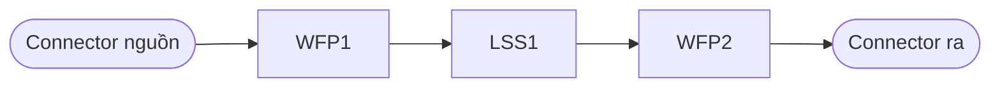

# helix-cc2-chain — Khối C1: ≥3 chuỗi C&C²

> **Vai:** sau C0, trước C2. Sinh các chuỗi khác nhau thật để CEO chọn; không chọn thay CEO.
> **Đầu vào:** `{{prefix}}CC2_C0_Frame.md` (+ `CC2_CA_Analysis.md` ở `--improve`) | **Đầu ra:** `{{prefix}}CC2_C1_Chains.md`
> | **Đọc bởi:** C2, orchestrator `--op`
> **Nguồn dùng chung:** `helix-cc2:references:synthesis-moves` (§Các nước đi, §Luật dùng), `helix-cc2:references:cc2-core`
> (§Từ vựng, §Hai loại nhãn, §Giới hạn dùng và bằng chứng), `helix-cc2:references:multidomain` (§Chỗ phải dừng),
> `helix-cc2:references:view-ops` (§Rào cản quan sát).

## Đầu vào

- Bắt buộc: `{{prefix}}CC2_C0_Frame.md`. Thiếu → liệt kê tệp thiếu và dừng, không dựng giả C0.
- Chế độ dự án: chạy theo từng `F-id` ở ô `dựng C&C²`, chức năng tới hạn trước. C1 đọc C0 ở **gốc** `<nơi ghi>/` và ghi
  tệp C1 vào `<nơi ghi>/<F-id>/`.
- Nếu `Phase2-Concept/` có `Concept_Selection.md` / `Morphological_Matrix.md`: đọc để biết nguyên lý P2 đã chọn.

## Luật cứng

1. **≥3 chuỗi** *(quy ước bộ skill)*, đặt tên `A`, `B`, `C`…. Khác nhau ở cách sắp WFP/LSS/Connector (thêm, bớt, tách, gộp,
   đổi LSS / tính chất WFP / Connector / trạng thái / miền — `synthesis-moves` §Các nước đi), không chỉ đổi kích thước.
   Đổi một con số là việc của C3, không phải một chuỗi mới.
   **Tiêu chí kiểm được** *(quy ước bộ skill)*: hai chuỗi chỉ tính là khác nhau khi khác ở ít nhất một trong bốn điểm:
   (a) số hoặc thứ tự phần tử WFP/LSS; (b) hiệu ứng vật lý hay miền của một LSS; (c) vị trí hoặc loại Connector;
   (d) trạng thái logic hay cấu trúc nhánh. Chỉ khác giá trị tham số thì không tính. Mỗi chuỗi mang một dòng
   `Khác chuỗi <X> ở: (a|b|c|d) …` (chuỗi đầu tiên ghi `Khác chuỗi: — (chuỗi gốc)`).
2. **Nguyên lý `chưa nêu`** (C0): đề xuất chuỗi ở **≥2 miền vật lý khác nhau** (≥2 miền, *quy ước bộ skill*). Mỗi chuỗi một
   dòng «vì sao miền này hợp với thông số C0», có nhãn. Đề xuất đa miền là **nguồn ý, không phải quyết định concept**.
3. **Có P2:** ưu tiên nguyên lý P2 đã chọn. Chuỗi khác miền với P2 ghi nhãn **«lệch P2 — CEO quyết»**; không loại, không
   tự đưa lên đầu.
4. **không dựng ma trận hình thái** và **không chấm DSO/VDI 2225** — đó là việc của
   `helix-p2-search`. Khối này chỉ cho chuỗi, không xếp hạng chuỗi.
5. **`--improve`:** bắt buộc có thêm một chuỗi `sửa tối thiểu` — hình thể hiện có, chỉ đổi tham số cần cho chức năng mới
   (`synthesis-moves` §Luật dùng); tính vào ≥3 chuỗi chỉ khi nó thật sự khác các chuỗi còn lại.
6. **Mỗi chuỗi vẽ tay lại được** trên một trang A4: Mermaid `flowchart LR`, vài phần tử, không cần phần mềm để hiểu
   (`cc2-core` §Giới hạn dùng và bằng chứng).
7. Chuỗi đi vào điện tử / phần mềm: ghi chỗ C&C² hết dùng được; phần tử cuối trong miền vật lý thành Connector có tên
   (`multidomain` §Chỗ phải dừng).
8. Mọi câu «do X nên Y» mang nhãn **tri thức / phỏng đoán / giả định**; không bịa số. Chưa có số thì không ghi số.
9. **Ví dụ là minh hoạ, không phải đầu ra mặc định** *(quy ước bộ skill)*: nếu miền của câu đầu vào trùng miền của một ví
   dụ, ít nhất một chuỗi phải nằm ngoài các cách sắp trong ví dụ.
10. **C1 không có cổng máy.** CEO kiểm ≥3 chuỗi, Mermaid, dòng Khác chuỗi ở Cổng 2; lint `--kind params` không áp cho
    tệp C1 (nó ra `NO_TABLE`).

## Bước

1. Đọc C0; rút thông số, Connector biên, nguyên lý.
2. Chọn ≥3 cách sắp khác nhau thật (luật 1–3, 5). Với mỗi cách, nêu nước đi nào của `synthesis-moves` sinh ra nó.
3. Với từng chuỗi: vẽ Mermaid; điền bảng phần tử; nêu trạng thái logic (nhánh do kích hoạt nào chọn); liệt kê mặt biên;
   viết dòng `Vì sao chuỗi này hợp thông số C0:` có nhãn.
4. Viết 1–3 dòng `## Phép nên làm tiếp` chọn theo rào cản quan sát của chuỗi (`view-ops` §Rào cản quan sát).
5. ⛔ **Cổng CEO 2 — chọn chuỗi.** Dừng. Trong khi chờ, hàng Cổng 2 của bảng Cổng CEO ghi `⏳ chờ CEO` ở cột Quyết định
   (chưa phải quyết định, theo khuôn trạng thái của orchestrator). CEO trả lời thì thay hàng ấy bằng ngày, `chuỗi chọn: B.1`
   và lý do, rồi mới sang C2. Các chuỗi `--op` sau này nối thành `B.1`, `B.2` vào cuối tệp này (orchestrator làm, không ghi đè).

## Khuôn đầu ra: `{{prefix}}CC2_C1_Chains.md`

````markdown
---
updated: YYYY-MM-DD
f_id: {{F-id hoặc —}}
nguyên lý: đã nêu: {{…}} | chưa nêu
---
# CC2 C1 — Chuỗi cho: {{chức năng}}

> Đề xuất đa miền là nguồn ý, không phải quyết định concept. Không dựng ma trận hình thái, không chấm DSO/VDI 2225.

## Chuỗi A — {{tên ngắn}}  ({{miền}}; {{lệch P2 — CEO quyết | theo P2 | sửa tối thiểu}})



| Phần tử | Loại | Làm gì | Nhãn |
|---|---|---|---|
| WFP1 | WFP | {{…}} | {{tri thức/phỏng đoán/giả định}} |

- Trạng thái logic: {{nhánh, kích hoạt chọn nhánh}}
- Mặt biên: {{…}}
- Khác chuỗi {{X}} ở: {{(a|b|c|d) …}}
- Chỗ C&C² hết dùng được: {{… | không có}}
- Vì sao chuỗi này hợp thông số C0: {{…}} ({{nhãn}})

## Chuỗi B — …
## Chuỗi C — …

## Phép nên làm tiếp
- {{phép}} · {{phần tử}} · {{câu hỏi kích hoạt}}
````

## Ví dụ ngắn (mức nguyên lý, giả định, không số, không tên sản phẩm)

### Ví dụ 1 — nguyên lý đã nêu

C0: câu chức năng «phát hiện vật che cắt một lối đi [quang→điện]» (rào sáng ở cửa hay băng chuyền), `Nguyên lý: đã nêu: quang→điện`.
Ba chuỗi cùng miền quang, khác cách sắp (cơ sở: `multidomain` ví dụ quang → điện):

- **A — rào sáng xuyên tia**: phát và thu hai bên lối đi, vật che cắt LSS giữa hai bên. Khác chuỗi: — (chuỗi gốc). `giả định`
- **B — rào sáng phản xạ ngược**: phát và thu cùng một bên, thêm WFP ở mặt phản xạ bên kia, LSS đi hai lượt.
  Khác chuỗi A ở: (a) thêm một WFP, LSS đi hai lượt; (c) Connector nguồn và mạch đọc cùng một bên. `giả định`
- **C — phản xạ khuếch tán từ chính vật**: phát và thu cùng một bên, không có mặt phản xạ riêng; mặt vật thành WFP trả sáng về.
  Khác chuỗi A ở: (a) WFP phản xạ là mặt vật, không thuộc hệ; (c) Connector cùng một bên; (d) logic đảo — có vật thì có
  sáng về. `giả định`


Phía sau mặt thu là mạch điện tử: C&C² dừng, Connector «mạch đọc» chuyển sang thiết kế mạch.

### Ví dụ 2 — nguyên lý chưa nêu

C0: câu chức năng «phát hiện nắp hộp đã đóng kín», `Nguyên lý: chưa nêu`. Ba chuỗi ở ba miền (≥2 miền), là nguồn ý,
không phải quyết định concept:

- **A — tiếp xúc cơ**: mép nắp ấn cần đàn hồi của một công tắc trên thân hộp; LSS là cần đàn hồi; hợp vì trạng thái
  «đóng» chính là chạm. Khác chuỗi: — (chuỗi gốc). `giả định`
- **B — từ**: nam châm gắn trên nắp, phần tử cảm từ gắn trên thân; LSS là khe không khí mà từ trường đi qua.
  Khác chuỗi A ở: (a) bớt WFP chạm nắp//cần; (b) LSS là trường từ qua khe thay vì cần rắn. `giả định`
- **C — quang**: nắp đóng chặn chùm sáng giữa nguồn và mặt thu đặt trên thân; LSS là khoảng không khí có chùm tia.
  Khác chuỗi A ở: (b) LSS là chùm sáng; (d) logic đảo — nắp đóng thì mất tín hiệu sáng. `giả định`

Cả ba chuỗi chỉ báo nắp ở vị trí đóng. «Kín» (không lọt bụi, nước) là một chức năng khác; C0 phải tách nó ra, không gộp
vào chuỗi phát hiện.

Chuỗi lệch P2 (nếu có P2) ghi `lệch P2 — CEO quyết`.

## Chạy riêng

```
/helix-cc2-chain [--function "<câu>" | --improve <hình thể> "<câu>" | --project <dự án>] [--out <thư mục>]
```

Đầu vào tối thiểu: `{{prefix}}CC2_C0_Frame.md` ở nơi ghi (chạy `/helix-cc2-frame` trước nếu chưa có). Chế độ dự án: truyền
`--out <nơi ghi>` (gốc, nơi có C0 và `_pipeline_state.md`), kèm chức năng con hiện hành: `current_f` trong `_pipeline_state.md` hoặc tiền tố `<F-id>/` như ở `--op`; C1 đọc và ghi trong `<nơi ghi>/<F-id>/`.

## COD

| Việc | Lớp | Ai |
|---|---|---|
| Sinh chuỗi, sơ đồ, bảng, «Phép nên làm tiếp» | **O** Offload | AI |
| Chọn chuỗi (Cổng CEO 2), quyết chuỗi «lệch P2» | **C** Core | CEO / kỹ sư |
| Quyết nguyên lý / miền khi `chưa nêu` | **C** Core | CEO — P2 là nơi quyết concept |
| Cập nhật `_pipeline_state.md` | **D** Default | tự động |
